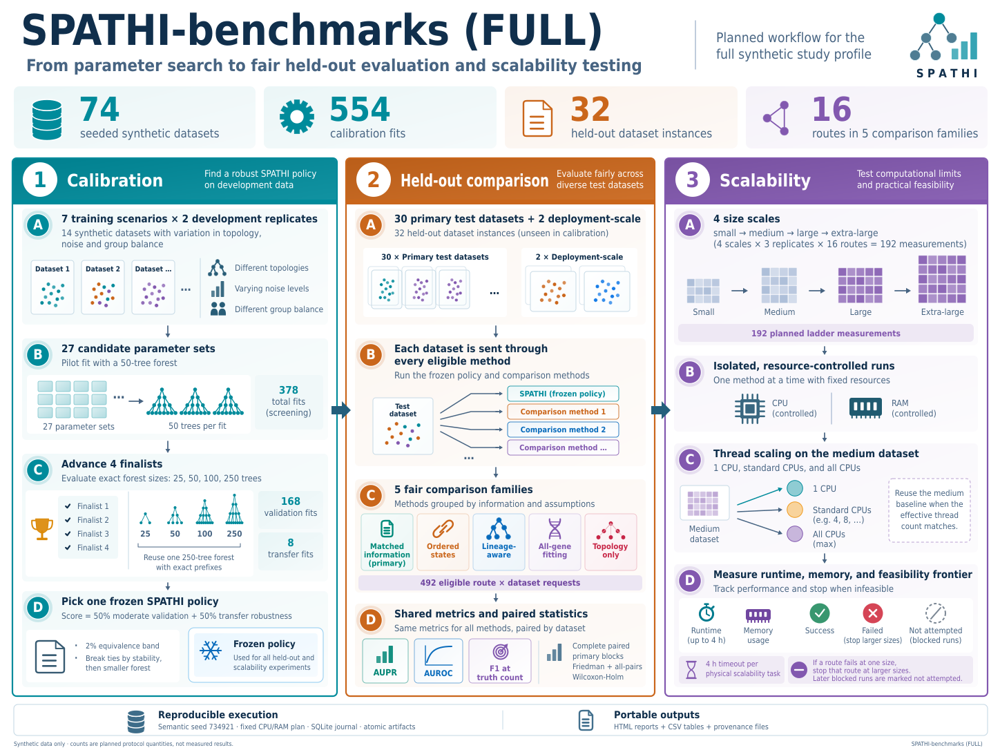

# SPATHI-benchmarks (FULL): graphical abstract reproducible



## Qué es esta versión

Este directorio reconstruye **mediante código y elementos vectoriales** la figura
ilustrada que se aprobó en la conversación: las tarjetas superiores, las tres
columnas, los doce pasos, sus textos, las miniaturas de datos y los iconos.

La referencia anterior se generó como una imagen rasterizada. **No existía un
código Python, DOT o TikZ original que produjera exactamente ese PNG.** Este
paquete no presenta una vectorización automática ni un PNG incrustado como si
fueran el código de aquella imagen. Es una reconstrucción nueva y cercana, no
una copia idéntica píxel a píxel: cambian ligeramente las formas de los iconos,
la tipografía y algunos espaciados.

`reference/original_ai_reference.png` conserva el PNG original sin modificar.
**El constructor no abre ni utiliza ese archivo.** Puede eliminarse por completo
la carpeta `reference/` y seguir generando la figura.

Los archivos que sí reproduce el código son los SVG, PDF y PNG de la
reconstrucción entregados en este directorio. La comprobación realizada en el
entorno registrado reproduce esos tres archivos **byte a byte** desde una
carpeta limpia que contiene solamente el constructor y sus dos JSON.

## Estructura del directorio

La figura y sus fuentes reproducibles residen bajo `docs/graphical_abstract/`,
siguiendo la organización de la figura de SPATHI.

```text
docs/graphical_abstract/
├── build_figure.py                 # Figuras e iconos construidos con primitivas
├── figure_config.json              # Paleta principal, fuentes, tamaño y metadatos
├── figure_text.json                # Títulos, descripciones y rótulos principales
├── requirements.txt                # Versiones probadas
├── verify_build.py                 # Auditoría + reconstrucción desde fuentes
├── README.md
├── SOURCES.md                      # Trazabilidad científica y notas de interpretación
├── CAPTION.md                      # Propuesta de leyenda en inglés
├── SPATHI_benchmarks_graphical_abstract.svg
├── SPATHI_benchmarks_graphical_abstract.pdf
├── SPATHI_benchmarks_graphical_abstract.png
├── comparison.html                # Original/reconstrucción; abre sin conexión
├── build_environment.json         # Versiones y hashes de las fuentes utilizadas
├── layout_checks.json
├── text_geometry.json
├── verification.json
├── provenance.json
├── SHA256SUMS
└── reference/
    └── original_ai_reference.png  # Solo referencia; no es una entrada del constructor
```

## Generar la figura

Se requiere **Python 3.10 o posterior** y la fuente **DejaVu Sans Condensed**, en
estilo normal y negrita. No se distribuyen archivos de fuentes en el paquete.

En Linux, la fuente suele estar disponible con el paquete `fonts-dejavu-core`.
El constructor comprueba los nombres de los archivos y no sustituye la fuente
silenciosamente. En otro sistema, pueden indicarse las fuentes ya instaladas
mediante `--font-dir`.

```bash
cd docs/graphical_abstract
python -m venv .venv
# Linux/macOS:
source .venv/bin/activate
# Windows PowerShell, en lugar de la línea anterior:
# .venv\Scripts\Activate.ps1

python -m pip install -r requirements.txt
python build_figure.py
```

Una vez instaladas las dependencias, la generación no necesita conexión a
Internet, claves de API, un servicio de generación de imágenes, Graphviz,
Inkscape, LaTeX, los repositorios científicos ni sus datos.

```bash
# Exportar en una carpeta distinta:
python build_figure.py --out-dir /tmp/spathi-figure

# PNG a mayor resolución; SVG y PDF siguen siendo vectoriales:
python build_figure.py --dpi 600

# Usar una ubicación concreta de fuentes:
python build_figure.py --font-dir /ruta/a/dejavu
```

Por defecto, el PDF mide 360 × 270 mm y el PNG se exporta a 300 ppp. El tamaño
físico puede cambiarse en `figure_config.json`. Para una revista, debe ajustarse
el tamaño final y
comprobarse la legibilidad; reducir este diseño a una columna estrecha puede
hacer demasiado pequeños sus textos secundarios.

## Qué formato utilizar

**SVG editable (`.svg`).** Conserva texto como texto y organiza los elementos
por grupos identificables. Requiere la fuente indicada para mantener la
apariencia. Es adecuado para retoques en un editor vectorial.

**PDF.** Vectorial, con texto seleccionable y subconjuntos de fuentes
incrustados. No contiene imágenes rasterizadas. Es la opción directa para
incluir la figura en un artículo LaTeX:

```latex
\usepackage{graphicx}
% En el documento:
\includegraphics[width=\textwidth]{docs/graphical_abstract/SPATHI_benchmarks_graphical_abstract.pdf}
```

**PNG.** Exportación rasterizada de la nueva figura vectorial para vistas
previas y aplicaciones que no acepten SVG o PDF. No debe confundirse con el
PNG original, que está dentro de `reference/`.

## Editar

Cambiar `figure_text.json` para modificar los títulos, descripciones y rótulos
principales. Cambiar `figure_config.json` para la paleta principal, la fuente,
el tamaño físico o los metadatos. Las etiquetas breves de algunos iconos y la
geometría de sus componentes están en funciones con nombres descriptivos de
`build_figure.py`.

La maquetación usa regiones acotadas y posiciones declaradas para conservar la
composición de la referencia. No se recalcula mediante un motor de grafos.
Los textos se ajustan al ancho asignado; cambios extensos pueden requerir
ampliar el bloque o modificar los saltos de línea. El constructor devuelve un
error cuando detecta solapamientos entre cajas de texto o texto fuera de sus
regiones. La revisión visual sigue siendo necesaria.

## Verificar

```bash
python verify_build.py
python verify_build.py --rebuild
```

La segunda orden crea una carpeta temporal y copia **solo** el `.py` y sus dos
JSON. A continuación genera de nuevo todos los archivos y compara sus hashes
con los de la entrega. Esta comprobación supone la configuración, resolución
por defecto, versiones y fuentes registradas en `build_environment.json`;
cambios de versiones o fuentes pueden cambiar los bytes sin cambiar el diseño.
Después de editar el diseño, ejecutar primero `python build_figure.py` y después
la verificación.

La auditoría de la versión entregada registra 169 elementos de texto y 739
primitivas vectoriales, sin desbordamientos ni solapamientos entre cajas de
texto detectados. El SVG carece de elementos `<image>`, scripts y recursos
externos enlazados. El PDF carece de imágenes rasterizadas. Los renderizados
se inspeccionaron con MuPDF y Poppler.

`comparison.html` permite alternar entre el PNG original y la reconstrucción,
o compararlos mediante un separador deslizante. Es un visor de referencia,
no una entrada del proceso de dibujo.

## Alcance científico y editorial

La figura conserva el contenido del diseño aprobado y se refiere a la
instantánea `9baa6bb8efb8e5b96b74bd9c9702a2c45de1ab75` del protocolo FULL.
**No representa resultados observados ni acredita que el benchmark se haya
completado.** No se ha ejecutado ningún experimento ni actualizado el protocolo
a una versión posterior. Ver `SOURCES.md` para los recuentos e interpretaciones.

La reconstrucción programática no cambia el origen asistido por IA del proceso
de diseño. Antes del envío debe revisarse la política de la revista aplicable
a la figura y a su declaración de asistencia. El formato vectorial no garantiza
por sí solo aceptación editorial.
